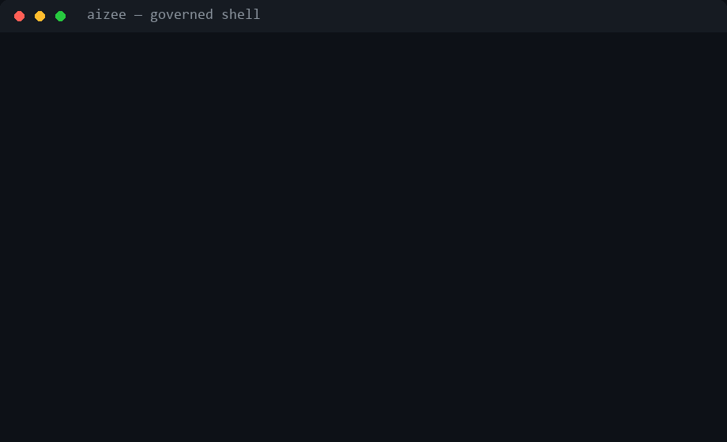

<div align="right" dir="rtl">
  
  <h1>aiZee — نظام التشغيل العالمي للذكاء الاصطناعي</h1>
  <p><strong>حول أي مساعد ذكاء اصطناعي إلى مهندسك الرئيسي — سيادة كاملة، جودة صفرية العيوب.</strong></p>

  <p>
    <a href="https://github.com/m3taz-ahmed/aizee/actions/workflows/validate.yml"></a>
    
    
    
    
  </p>
  <p>
    
    
    
    
  </p>
</div>

---

<div dir="rtl">

[اقرأ النسخة الإنجليزية](https://github.com/m3taz-ahmed/aizee/blob/main/README.md) · [سجل التغييرات](https://github.com/m3taz-ahmed/aizee/blob/main/CHANGELOG.md) · [دليل التثبيت](#التثبيت)

---

## شوفه يمنع حاجة

<div align="center">
  
</div>

```console
$ aizee check 'Bash' --args '{"command":"git add .env && git commit -m keys"}'
{
  "ok": false,
  "decision": "deny",
  "reason": "guardian: commits secrets file .env"
}

$ aizee doctor --json | jq .verdict
"ready"
```

كل استدعاء أداة، طلب LLM، كتابة ذاكرة، أو تغيير ملف بيمر عبر `Kernel.act()` — **Probity → Guardian → Policy → LoopDetector → Budget → Audit** — فالرفض جدار مش مجرد اقتراح.

## ما هو aiZee؟

**نظام تشغيل محكم الإصدار** يجلس بينك وبين كل مساعد ذكاء اصطناعي — Cursor، Claude، Copilot، Windsurf، Cline، Aider، Devin — ويفرض معايير الهندسة وسياسات الأمان والانضباط المعماري على كل سطر كود مولّد.

**المشكلة التي يحلها:** المساعدات الذكية تهلوس APIs، تنسى الاتفاقيات، تتجاهل الأمان، وتشحن ديونًا تقنية صامتة. aiZee يجبرها على القراءة من مصدر حقيقة مركزي *قبل* كتابة سطر واحد — وفي v6 يتحقق من كل إجراء *أثناء* تنفيذه، لا مجرد توثيق بعده.

| بدون aiZee | مع aiZee |
| :--- | :--- |
| انحراف السياق بعد عدة prompts | القواعد والشخصيات تُحمّل كل جلسة |
| حزم قديمة وديون تقنية صامتة | تثبيت إصدار دقيق عبر MCP حي |
| SQL خام، XSS مفقود، أسرار ضعيفة | OWASP و zero-trust و RBAC مفروضة |
| إعادة هيكلة عشوائية | تغييرات جراحية عبر بوابات policy + budget + audit |
| حواجز حماية موجودة لكن خارج المسار | **v6: الإنفاذ مربوط بـ `Kernel.act()` وكل استدعاء MCP** |

---

## الجديد في v6.9.0 — تبنّي أدوات الإبداع

عشرة أنماط معمارية متبنّاة (إعادة تنفيذ نظيفة) من دراسة عشر أدوات إبداعية
مفتوحة المصدر — OpenToonz وFriction وFreeMoCap وSynfig وEffekseer و
Theatre.js وPencil2D وOpenVDB وSVG.js وNatron — للمبرمجين *و* المصممين
(التقرير: `ideas-repo-study-2026-11.md`):

- **ناقل أحداث** (FreeMoCap) — pub/sub مُنمّط داخل الكيرنل؛ الداشبورد
  يسحب الأحداث لايف، و`aizee events tail` من الـCLI.
- **تخزين الخطوات** (Natron) — كل استدعاء يتخزّن ببصمة محتواه؛
  `aizee plan run --memo` يعيد النتيجة بدل إعادة الشغل.
- **باني خطط سلس** (SVG.js) — `runtime/plan_builder.py` يكتب الخطة بسلسلة
  استدعاءات بدل تحرير JSON يدويًا — نفس الصيغة الآمنة المتحققة.
- **تحميل استباقي** (OpenToonz) — `--lookahead N` يجهّز موارد الخطوات
  الجاية على خيط خلفي (قراءة فقط ومحدود).
- **واجهة من المخطط** (Theatre.js) — `aizee ui --spec '{...}'` يولّد أدوات
  تحكم (سلايدر/قوائم/حقول) تلقائيًا من الأنواع.
- **إعادة تشغيل زمنية** (Theatre.js) — `aizee replay` يعرض سجل التدقيق
  كشريط زمني تتحرك فيه (قراءة فقط).
- **مزرعة مهام** (OpenToonz) — `aizee farm` توزّع الشغل على عمال بعقود
  إيجار ونبضات قلب وإعادة جدولة عند السقوط.
- **قيم مترابطة** (Synfig/Friction) — `$step.s0` و`$mem.<key>` تتحلّل
  داخل تعبيرات الخطة (لسة بدون `eval`).
- **لقطات ذاكرة** (OpenVDB) — `aizee memory snapshot` يصدّر نسخة
  read-only مضغوطة ومفضوطة بالشيكسوم.
- **عرض الظل** (Pencil2D) — `aizee plan ghost` يوريك الخطة هتعمل إيه
  قبل ما تنفّذ؛ و`WorkingSet` يحصر الذاكرة المؤقتة في كل الأنظمة الجديدة.
- **تحليل أثر التغيير** (Understand-Anything) — `aizee impact` بيربط
  الملفات المتغيرة بجراف الاعتماديات ويحسب الـblast radius: الملفات
  المتأثرة والاختبارات اللي لازم تتعاد والطبقات المعمارية.
- **جولة معمارية** (Understand-Anything) — `aizee tour` يمشيك في
  الكود من الأساس للواجهة: المجتمعات مترتبة بوزن الاعتماد عليها مع
  أهم الملفات وطبقة كل محطة.

## الجديد — مكتبة مهارات موحدة + بيئة BMAD (v6.8.0+)

سطح المهارات كبر من 155 لـ**245 مهارة** — منظومة agent-skills كاملة بقت مدمجة جوه الريبو، مربوطة بالشخصيات، والتريجرز مترجمة (EN+AR)، والنزاهة مقفولة بالـlock:

- **BMAD-METHOD مدمج بالكامل** — كل مهارات BMAD (~34: `bmad-*`، `bmod-*`) عايشة في `skills/` مع بيئة `_bmad/` المحلية (config + scripts + شجرة التذاكر). الوكلاء: **Mary** (محللة)، **John** (PM)، **Winston** (مهندس معماري)، **Sally** (UX)، **Sofia** (PO)، **Amelia** (مطورة) — بيناديهم بلغة طبيعية، من غير تثبيت global.
- **حزمة تسويق/نمو** — ~55 مهارة (seo-audit، ai-seo، cro، ads، cold-email، launch، pricing، paywalls، onboarding، referrals، revops…) بتريجرز ثنائية اللغة.
- **توجيه شخصيات واعٍ بدورة الحياة** — `runtime/lifecycle.py` بيقرا الـinitiative النشطة في BMAD (`_bmad/config.toml` + artifacts في `_bmad-output/`) وبيميل اختيار الشخصية للمرحلة الحالية (discovery → PRD → breakdown → architecture → UX → implementation → review → retro). المشاريع بدون BMAD مش بتتأثر.
- **تلميحات التسليم** — `detect_multiple` بيرجّع `next_persona_hint`: أقوى شخصية خارج المختارين، بتتحقن في السياق عشان المهام متعددة المجالات تنتقل بسلاسة.
- **توزيع المهارات لكل مشروع** — `scripts/distribute-agent-skills.py` بيعمل junctions/hardlinks لكل الـ245 مهارة في `.agents/skills` (كل agent harness: Devin، Claude، Cursor، Codex…) + `.claude/skills` + `.devin/skills` — مفيش حاجة بتفضل global فالجلسات التانية تفضل خفيفة.
- **إثراء التريجرز + lint** — المهارات المستوردة خدّت تريجرز عربية؛ السكريبتات `enrich-imported-triggers.py` / `enrich-bmad-triggers.py` قابلة لإعادة التشغيل بعد تحديثات upstream.
- **شخصية FINOPS اتصلحت** — مهارة `finops` مخصصة جديدة بدل الربط الغلط بـ`performance-engineer`.
- **مانيفست الاعتماديات الخارجية** — `deps.yaml` بيعلن كل أداة محتاجاها aiZee (binaries، pip، git-repos، docker، env)؛ `aizee deps check|install` بيتحقق ويوفّرها (شوف [الأدوات الخارجية](#الأدوات-الخارجية--التوفير-التلقائي)).

التحليل الكامل: `tech-stack/persona-bmad-review.md`.

## الجديد في v6.7.0 — تبنّي vercel-labs

من مسح 396 مستودعًا في vercel-labs (28 بدراسة عميقة؛ التقرير في `vercel-labs-study-2026-11.md`):

- **محرك خطط خاملة** — `aizee plan validate|run|resume`: خطط JSON بأسلوب callscript — بلا eval، تحقق شامل، حدود على fan-out والاستدعاءات، إيقاف/استئناف قابل للتسلسل دون إعادة تنفيذ الخطوات المنجزة، وبصمة `plan_hash` للتدقيق.
- **قفل المهارات** — `skills-lock.json` يثبّت كل مهارة ببصمة مجلدها؛ `aizee skill lock-check` يكشف التعديل/الحذف/غير المقفل، و`lock-update` يعيد البناء.
- **lint مواصفات SKILL.md** — أسماء kebab-case، ملف `SKILL.md` بالضبط، حد 500 سطر (progressive disclosure) داخل `aizee skill lint`.
- **تجميد سطح أدوات MCP** — `aizee mcp freeze <server> [--check]` يقفل تعريفات الأدوات ويكشف أي أداة مضافة/محذوفة/متغيّرة.
- **بوابة انحراف الدوكس** — `aizee check-docs` يتحقق من روابط `wiki path#symbol refs` (أسلوب lat.md).
- **كتالوج models.dev أوفلاين** — `aizee models --catalog [--query]`: 886 نموذجًا/12 مزوّدًا من نسخة مثبّتة.
- **عقد الأخطاء** — `AizeeError.scope`/`public` + `to_public_dict()` لتنقية أخطاء MCP/CLI.
- **طبقة التفعيل** — كل قدرة موصولة للاستخدام التلقائي مش مجرد مثبّتة: قسم `Command Surface & Auto-Triggers` في `AGENTS.md` (ينتشر لكل محوّلات الوكلاء) + 4 مهارات trigger (`inert-plan-runner`، `mcp-surface-integrity`، `docs-drift-check`، `skill-lock-integrity`) عشان كشف الشخصيات يقترح الأمر الصح في الوقت الصح، وقواعد أحداث تشغّل البوابات (بعد التثبيت → lock-check، تغيير MCP → freeze --check، تعديل دوكس → check-docs) بدون ما تسأل.

## الجديد في v6.6.0 — موجة تبنّي Repo-Study

اتبنّت من دراسة منظمة لـgoogle/elephant-goldfish-model وwotschofsky/domain-digger وgodotengine/godot (التقرير الكامل في `repo-study-2026-11.md`):

- **مراجعة مواصفات Goldfish** — `aizee spec review <spec_id|--file> [--preset]` بيخطّط pipeline مراجع بسياق صفري جديد (منقولة من EGM): فصل دلالي spec/plan، 5 شخصيات مراجع على مراحل، فرز شدة + تجميع تتبع. المعايير والشخصيات المرخّصة Apache-2.0 تحت `resources/`؛ الوركفلو: `workflows/65-goldfish-review.md`.
- **تغليف مهارات متعدد المحفّزات** — `aizee skill link --pack <dir>` بيطلّع حزمة محمولة بأسلوب EGM: `plugin.json` قانوني + manifests لـ`.claude-plugin/` و`.codex-plugin/` و`.cursor-plugin/` و`.agents/` + `skills/` و`agents/` و`resources/` vendored. الاستبدال fail-closed على وجهات مش حزم.
- **عدّة استخبارات نطاق** — `aizee intel <domain>` + 7 أدوات MCP (`runtime/dns_wire.py` + `runtime/domain_intel.py`، إعادة كتابة بايثون لمفاهيم domain-digger): codec بصيغة DNS wire، UDP→TCP fallback، مشي authoritative تكراري، DoH، WHOIS، تاريخ شهادات، وتعداد subdomains — كلها محدودة وfail-closed.
- **تقييم سيناريوهات المهارات** — `eval/skill_scenarios.py` بيشغّل فحوص سلوكية static/live (`eval/scenarios/goldfish-review.yaml`) ويدخلها في الـharness كبوابة `skill-scenarios`.
- **مرجع Godot** — سورس المحرك الكامل مثبّت تحت `refs/godot` (محلي فقط) + `tech-stack/godot-4.md` بيسجّل التثبيت المحمول الموثّق (`4.7.2.stable.official`) لخط GAME.

## الجديد في v6.1.0 — سطح أخف وأصدق

التغيير الجوهري: **السطح الافتراضي صغير وصادق**. أسطول MCP انخفض لما يُستخدم فعلًا، وحدات أدوات التسويق معطّلة لا محذوفة، الكود الميت أُزيل، والمثبّتات تحذف الملفات المتقاعدة عند الترقية.

### افتراضيات أخف

- **3 خوادم MCP افتراضيًا** — `aizee` (الحوكمة)، `graphify`، `context7`. خوادم التسويق/السوشيال/الفريلانس اختفت من كل الإعدادات المشحونة.
- **46 أداة MCP مفعّلة** — 7 وحدات أدوات تسويقية (ads, analytics, CRO, email, freelance, SEO, social) لا تزال مشحونة لكنها معطّلة عبر `disabledToolModules` في `aizee_mcp/config.json`. أزل الاسم لإعادة تفعيلها.
- **31 إضافة معطّلة** — `plugins.yaml` يشحنها `enabled: false`؛ والصندوق الرملي يحجب الباقي. `code2video` و`graphify` و`context7` يبقون.
- **كود ميت أُزيل** — وحدات runtime غير مستخدمة (`a2a_server`, `semantic_search`, `provider_registry`, `sql_injection_guard`, `plugin_system`, …) وتيستاتها حُذفت.

### نظافة الترقية

- **تنظيف الملفات المتقاعدة** — `scripts/stale_files.txt` يسرد المسارات المتقاعدة؛ `install.ps1` و`install.sh` و`scripts/update.py` يحذفونها من التثبيتات القائمة مع الحفاظ على `state/` و`brain/` و`.env`.
- **شجرة تيست موحّدة** — كل التيستات تحت `tests/{runtime,memory,eval,aizee_mcp,…}`.
- **مكتبة تصميم مزروعة** — `design-library/` تشحن الآن بذور `DESIGN.md` حقيقية (editorial, midnight, minimal) فلا يعود `DesignLibrary` يحل كتالوجًا فارغًا.
- **ضغط تلقائي لـ Memory.md** — تُحفظ تحت سقف 500 سطر عبر `aizee memory compact` (الأرشيف في `memory/archive/`).

### خلاصة v6.0.0 — Runtime محكوم فعليًا

انتقل الإنفاذ إلى مسار التنفيذ في v6.0.0:

- **`runtime/enforcement.py`** — مكوّن إنفاذ موحّد: جدار MCP → فحص AgentGateway للطلب → التنفيذ → فحص الاستجابة → التدقيق. مشترك بين كل مسارات الاستدعاء.
- **`Kernel.act()`** — أحكام AgentGateway (ALLOW / REDACT / BLOCK) تحكم الإجراءات الحقيقية؛ فحوص الحقن وتسريب الأسرار تطبّق على حقول الشكل النصي دون حظر كتابة الملفات العادية.
- **MCP الصادر** — `McpClient` (متزامن + غير متزامن) و`McpAgent` يشغّلان الجدار والبوابة حول كل استدعاء خارجي.
- **MCP الوارد** — أدوات خادم aiZee تحتفظ بـ RBAC *وتُغلّف* بفحوص البوابة.

### عمق الكشف

- **كاشف الحقن L1→L3** — 13 تقنية بأنماط + طبقة تشابه دلالي (embeddings) + خيار LLM-judge. حتمي بدون نماذج افتراضيًا.
- **Dual-LLM مقوّى** — مخرجات العامل المعزول مُقيدة بمخطط Pydantic؛ فشل التحليل آمن (fail-safe).
- **MCP 2026-07-28 عديم الحالة** — تفاوض `protocolVersion` لكل طلب + توجيه بترويسات `Mcp-Method`/`Mcp-Name`.

### عمق الحوكمة

- **أحكام APL** — يمكن للسياسات الآن `modify` (إعادة كتابة الحمولة، مدقّقة) و`observe` (سماح + تسجيل) بجانب allow/ask/deny.
- **خطافات دورة الحياة** — طورا `output.pre_send` و`memory.pre_write`؛ الخطافات تستطيع النقض أو التعديل.
- **`aizee heal`** — منسّق إصلاح آمن (dry-run افتراضيًا، `--apply` بتأكيد، تدقيق في `state/heal.log`).
- **ميزانيات لكل PR** — حدود إنفاق تراكمية بمفتاح PR (`AIZEE_PR_ID`) فوق نوافذ الجلسة/الساعة/اليوم.
- **بوابة الإصدار** — `eval/release_gate.py` يشغّل سلم الأولويات للموثوقية على rollouts المسجلة؛ مربوط بـ `aizee ci`.
- **جناح الفوضى** — `eval/chaos.py` سيناريوهات حقن أعطال + حساب موازنات الأخطاء.

### الذاكرة وأسطح البروتوكول

- **ذاكرة ثنائية الزمن** — `store.as_of(as_of=..., valid_at=...)` تفرّق بين "ماذا عرفنا وقتها" و"ما الذي كان صحيحًا وقتها"؛ تثبيت، حذف ناعم بختم زمني، علاقات تناقض.
- **`aizee memory compact`** — ضغط تلقائي لـ Memory.md (سقف 500 سطر، إنقاذ `[PINNED]`، أرشفة في `memory/archive/`).
- **Code Mode** — `aizee codemode` ينفّذ مقاطع Python معزولة تستدعي أدوات MCP مباشرة (فحص AST + builtins مقيّدة + جسر محكوم + مهلة).
- **`aizee bootstrap`** — يبني جذر OS أدنى بعد `pip install aizee` (idempotent، dry-run افتراضيًا).
- **تدقيقات استشارية** — `aizee task overcheck` (إشارات الهندسة الزائدة من الخطة + الرسم)، `aizee task curriculum` (خطة تعلّم مرحلية من مراجع tech-stack).
- **تسليم عبر الوكلاء** — `aizee memory handoff --to-harness` يختم وثيقة `aizee.handoff.v1` محمولة في خزنة النطاق (`brain/handoffs/`، حارس gitignore مُحكم الإغلاق) فيكمل الوكيل الآخر من حيث توقف هذا.
- **الغرائز المكتسبة** — `aizee memory instinct-*` يسجّل سلوكيات ذرية trigger→action بثقة 0.3→0.9؛ ملاحظتها في ≥2 مشروع ترقّيها تلقائيًا لنطاق المستخدم.
- **تدقيق سلسلة إمداد MCP** — `aizee security mcp` يفحص إعدادات MCP المكتشفة (متسامح مع JSONC) عن أسرار بنص صريح في `env` و`args`، حزم `npx`/`uvx` غير مثبّتة، مسارات أوامر قابلة للكتابة، وانجراف rug-pull مقابل الخطوط المرجعية.
- **حارس فرض الحقائق** — الأوامر الهدامة القابلة للاسترداد (force-push، hard reset) تمرّ فقط بحقائق صريحة `{target, rollback}`؛ الكارثية تبقى محظورة دائمًا.
- **خط دفاع ضد الحقن** — كل ملف قواعد مُصدَّر يحمل قسمًا ثابتًا مضادًا للحقن (قفل الهوية، عدم إفصاح الأسرار، محتوى خارجي غير موثوق، اشتباه بحيل unicode).

التفاصيل الكاملة: [CHANGELOG.md](https://github.com/m3taz-ahmed/aizee/blob/main/CHANGELOG.md)

---

## البدء السريع

### المتطلبات

| المتطلب | الحد الأدنى | الموصى به |
| :--- | :--- | :--- |
| Python | 3.10 | 3.12 |
| Git | 2.30+ | الأحدث |
| النظام | Windows 10 / macOS 12 / Ubuntu 22.04 | الأحدث |

### التثبيت

```bash
git clone https://github.com/m3taz-ahmed/aizee.git .ai
cd .ai
```

**Windows — واجهة رسومية** (double-click على `install.bat` أو):
```powershell
.\install.ps1 -Gui
```

**Windows — سطر أوامر:**
```powershell
.\install.ps1
```

**macOS / Linux:**
```bash
bash install.sh
```

**PyPI:**
```bash
pip install aizee
aizee bootstrap --target ~/.aizee --yes   # بناء جذر OS أدنى
export AIZEE_ROOT=~/.aizee
```

### التحقق

```bash
aizee doctor    # فحص صحة (46 فحصًا)
aizee heal      # تشخيص + إصلاح آمن (dry-run؛ --apply للتنفيذ)
aizee status    # الشخصية، المهارات، الميزانية
aizee deps install   # توفير الأدوات الخارجية المعلنة في deps.yaml
```

### التحديث

للنسخة **الموجودة أصلًا** (مش تثبيت جديد) — ملف واحد بيعمل كل حاجة:

- **ويندوز:** دبل-كليك على `update.bat`
- **أي نظام:** `python scripts/update.py --yes`

اللي بيحصل: `git fetch` → حفظ أي تعديلات محلية (استرجاعها بـ `git stash pop`) → `git pull --rebase` → خطوات ما بعد التثبيت + تنبيه `aizee deps check`. بياناتك المتعلمة (`memory/`، `state/`، `brain/`، `.env`) متجاهلة في git ومحفوظة دائمًا. للمعاينة أولًا: `python scripts/update.py --dry-run`.

للانتقال مباشرة لإصدار معيّن: `git checkout vX.Y.Z` ثم `python scripts/update.py --post-install-only`.

---

## الأدوات الخارجية والتوفير التلقائي

بعض مميزات aiZee محتاجة سوفتوير **خارج** الريبو ده — أدوات CLI، حزم pip، عدّة ميديا، صور docker، مفاتيح API. كلها معلنة في **`deps.yaml`** (44 مدخل) فمفيش متطلب صامت:

```bash
aizee deps check            # تقرير كل اعتمادية: ok / missing / wrong version
aizee deps check --tag video # فلترة بالمجموعة (video, devx, agent, media…)
aizee deps install           # توفير كل غير المُرضى (أوامر لكل OS)
aizee deps install --dry-run # معاينة الأوامر بدون تنفيذ
aizee doctor                 # حكم deps داخل تقرير الصحة
```

`install.ps1` / `install.sh` / `scripts/update.py` بيشغّلوا `aizee deps check` كـpost-install hook وبياخدوا موافقتك على تثبيت الناقص — يعني clone جديد بيوصل للقدرة الكاملة بأمر واحد.

| الفئة | أمثلة | مطلوبة لـ |
| :--- | :--- | :--- |
| **الأساسية (مضمّنة)** | Python 3.10+، SQLite، pyyaml، pydantic | كل حاجة — صفر تثبيتات إضافية |
| **DevX CLIs** | repomix، code2prompt، oxlint، agent-browser | تجميع السياق، ريبو→برومبت، lint للـJS، تصفح للـagents |
| **Spec/SDD** | specify (spec-kit)، openspec، spec-kitty، spec-workflow-mcp | سير عمل التطوير الموجّه بالمواصفات |
| **الأتمتة** | n8n، super-productivity، gitbutler | أتمتة workflows، إدارة مشاريع، فروع git |
| **عدّة الميديا** | cinecode، bang-motion، motion-graphics (`~/.aizee/media`) | إنتاج فيديو/موشن (اختياري) |
| **ComfyUI** | `~/.aizee/media/apps/ComfyUI` + custom nodes | توليد صور/فيديو محلي (اختياري، GPU) |
| **Docker** | Docker Desktop + صورة `code2video` | رندر بلجن code2video (اختياري) |

**اختيارية بالتصميم:** اعتماديات الميديا/الفيديو بـ`severity: optional` — الحوكمة الأساسية والشخصيات والمهارات والذاكرة وMCP شغالين كامل بدونها. `aizee deps check` بيقولك بالظبط كل ميزة ناقصها إيه والأمر الواحد اللي بيصلحها.

---

## المعمارية الأساسية

```
.ai/                         # الجذر السيادي (يُكتشف عبر AIZEE_ROOT)
├── AGENTS.md                # البوتلودر المرجعي لكل الأدوات
├── global-roles.md          # 29 شخصية + قواعد تشغيلية
├── global-workflow.md       # بروتوكول التحميل المعرفي والتنفيذ
├── runtime/                 # النواة: policy، budget، audit، 139 وحدة حوكمة
│   ├── kernel.py            # الواجهة — Probity → Guardian → Policy → Loop → Budget → Audit
│   ├── enforcement.py       # مكوّن إنفاذ موحّد (firewall + gateway)
│   ├── agent_gateway.py     # حواجز طلب/استجابة (ALLOW/REDACT/BLOCK)
│   ├── injection_detector.py# L1 أنماط + L2 دلالي + L3 حكم LLM
│   ├── lifecycle.py         # كشف مرحلة BMAD → انحياز توجيه الشخصيات
│   ├── codemode/            # تنفيذ code-mode معزول فوق أدوات MCP
│   └── policies/            # YAMLs: default/guardian/probity/mcp_firewall
├── memory/                  # SQLite + FTS5 + vector، استعلامات ثنائية الزمن
├── aizee_mcp/               # خادم MCP (46 أداة مفعّلة، 3 موارد)
├── eval/                    # معايير، فوضى، موثوقية، بوابة إصدار
├── skills/                  # 245 مهارة (شخصيات + lords + BMAD + تسويق)
├── _bmad/                   # بيئة BMAD التشغيلية (config/scripts — gitignored)
├── .agents/skills           # توزيع junctions لمحفّزات الوكلاء
├── deps.yaml                # ماني فيست الاعتماديات الخارجية (check/install)
├── workflows/               # 66 بروتوكول تنفيذ بالمحفزات
├── rules/                   # قواعد سلوكية مضغوطة
├── tech-stack/              # 271 مرجعًا مثبتًا بالإصدار
├── dashboard/               # لوحة ويب (Python stdlib HTTP)
├── scripts/                 # مثبتات، مدققون، أغلفة MCP
├── install.ps1 / install.sh # مثبّت نظام التشغيل idempotent
└── pyproject.toml           # بيانات الحزمة + إعدادات الجودة
```

---

## الأعمدة الستة

### 1. تركيب الشخصية + المهارة
29 شخصية (`ARCH`، `QA`، `SEC`، `DEV`، `SRE`، `DATA`، `ML`، `MLOPS`، `FINOPS`، `DEVOPS`، `API`، `FREELANCE`، `MARKETING`، `GROWTH`، `BRAND`، `EMAIL`، `SOCIAL`، `CRO`، `SALES`…) مع مهارات lord للمجالات. تُكتشف تلقائيًا لكل مهمة — بلا اختيار يدوي.

طبقتا توجيه فوق الـkeyword scoring:

- **انحياز مرحلة دورة الحياة** — لما يكون فيه BMAD initiative نشط، الـartifacts في `_bmad-output/` بتكشف المرحلة الحالية (PRD → architecture → stories → review) و`runtime/lifecycle.py` بيميل الاختيار للـpersona المطابقة (مثلاً منتصف التنفيذ → `DEV`، منتصف المراجعة → `QA`+`ARCH`).
- **تلميحات التسليم** — النتيجة بتحمل `next_persona_hint`: أقوى شخصية خارج المجموعة المختارة، عشان المهام متعددة المجالات ("راجع التصميم وبعدين نفّذ") تنتقل بسلاسة.

```bash
aizee persona detect --multi "build a secure docker API with postgres"
# → Primary: ARCH + Secondary: SEC, DEVOPS + Lords: security-lord, cloud-platforms-lord
# + lifecycle_phase / next_persona_hint لما يكون فيه BMAD initiative نشط
```

### 2. حوكمة وقت التشغيل
كل إجراء يمر بخط البوابات قبل التنفيذ:

```
Probity → Guardian → Policy → Loop Detector → Budget → Audit
        └─ AgentGateway: أحكام حقن + تسريب أسرار (v6)
```

- **محرك السياسات** — قواعد YAML `allow/ask/deny/modify/observe` بتقييم آمن
- **جدار MCP** — بوابة قائمة على القواعد لاستدعاءات الأدوات الصادرة
- **AgentGateway** — حواجز طلب/استجابة على كل مسار مُنفَّذ
- **مدير الميزانية** — حدود tokens/cost/calls لكل جلسة/ساعة/يوم/أسبوع/شهر **ولكل PR**
- **سجل التدقيق** — مربوط بتجزئة SHA-256 وموقّع Ed25519، كاشف للعبث
- **منفّذ سير العمل** — تنفيذ durable مدعوم بـ SQLite مع تعويض saga

### 3. حقيقة أرضية حية
Context7 MCP يجلب وثائق المكتبات الحالية قبل التنفيذ. رسم المعرفة graphify يحل محل `grep` الأعمى للتنقل في الكود.

### 4. ذاكرة هجينة
SQLite + FTS5 بحث نصي كامل + فهرس vector اختياري (SentenceTransformers). طبقات episodic وsemantic وfactual وprocedural — الآن مع تثبيت، حذف ناعم، روابط تناقض، سلامة HMAC، واستعلامات `as_of` ثنائية الزمن.

```bash
aizee memory ingest                # إعادة بناء الفهرس بعد التغييرات
aizee memory search "docker"       # بحث نصي + دلالي
aizee memory compact               # إبقاء Memory.md ضمن سقف الأسطر
```

### 5. بوابات الجودة (صفر عيوب)
```bash
ruff check .                 # 0 تحذيرات
mypy                         # كتابة صارمة
aizee test --full            # المجموعة الكاملة + التغطية (fail-under=100)
python eval/harness.py       # تقييم E2E: ruff + mypy + pytest + validate-globals
```

### 6. كفاءة الرموز
كشف الشخصيات محلي (Python خالص، صفر tokens LLM). Code Mode يستبدل ذهاب-إياب JSON لاستدعاء الأدوات بمقاطع معزولة تستدعي الأدوات مباشرة — tokens تنسيقية أقل بشكل ملموس في مهام الأدوات المتعددة.

---

## خريطة الإنفاذ في وقت التشغيل

| المسار | البوابات المطبقة |
| :--- | :--- |
| `Kernel.act()` | Probity → Guardian → Policy → Loop → Budget → Audit + فحوص prompt لـ AgentGateway |
| MCP الصادر (`McpClient`، `McpAgent`، `aizee mcp call`) | mcp_firewall → طلب البوابة → تنفيذ → استجابة البوابة |
| MCP الوارد (أدوات `aizee_mcp`) | RBAC + تغليف طلب/استجابة بالبوابة |
| الدردشة (`kernel.chat_message`) | prompt_gate → … → خطافات `output.pre_send` |
| كتابات الذاكرة | خطافات `memory.pre_write` (نقض/تعديل) + سلامة HMAC |
| Code Mode (`aizee codemode`) | فحص AST + builtins مقيّدة + `call_tool` محكوم |

---

## لوحة القيادة

```bash
python dashboard/server.py 8080
# → http://127.0.0.1:8080
```

واجهة مركز قيادة داكنة أولًا: لوحة أوامر (`Ctrl+K`)، مقاييس bento، حبوب حالة، ألواح زجاجية. مصادقة Bearer اختيارية عبر `AIZEE_DASHBOARD_TOKEN`.

**التبويبات:** نظرة عامة · مستكشف الذاكرة · رمل السياسات · سير العمل · Sagas · دردشة · Tech Stack · قياسات · صحة النظام · سجلات التدقيق · **الإعدادات**

> **مهم — عطّل خوادم MCP التي لا تستخدمها.** كل خادم مفعّل يستهلك ذاكرة وقد يولّد عملية فرعية عند أول استدعاء. بعد التثبيت، افتح **Settings → MCP Servers**، ألغِ ما لا تحتاجه (**Uncheck All** ثم أعد تحديد المطلوب)، واضغط **Save Changes**. النواة تعيد التحميل تلقائيًا عند الحفظ.

الإعدادات تُحفظ في `state/settings.json` (gitignored، تنجو من التحديثات). ترحيلات المخطط تعمل تلقائيًا — النسخ القديمة تُحفظ كنسخة احتياطية.

---

## الأوامر الرئيسية

| الأمر | الوظيفة |
| :--- | :--- |
| `aizee doctor [--json]` | حكم الصحة + خطوات إصلاح مرتبة Run:/Guidance: |
| `aizee heal [--apply] [-y]` | تشخيص + إصلاحات آمنة تلقائية (dry-run افتراضيًا) |
| `aizee check <action>` | حكم السياسة على إجراء |
| `aizee find "<need>"` | بحث بلغة طبيعية على skills/workflows/tech-stack/routines |
| `aizee goal "<objective>"` | ربط هدف بأفضل workflow + خطوات |
| `aizee routine list\|match\|begin\|done\|seen` | روتينات دورية: دوسييهات مُسمّاة + حالة ثابتة عبر الجلسات |
| `aizee config show` | لقطة إعدادات مقنّعة |
| `aizee config apply <file> --check` | التحقق من ملف إعدادات (بدون كتابة) |
| `aizee spec propose\|changes\|archive` | مجلدات تغييرات بأسلوب OpenSpec |
| `aizee gateway init\|serve` | بروكسي LLM محكوم (failover + إنفاذ) |
| `aizee models` | كتالوج توجيه النماذج (مستويات + تكلفة) |
| `aizee work poll` | قضايا GitHub المفتوحة عبر `gh` (نموذج السحب) |
| `aizee skill link` | تثبيت SKILL.md في محفّزات الوكلاء |
| `aizee skill lint [--write-index]` | lint الأوصاف + كشف تصادم التريجرز |
| `aizee skill scan` | فحص حقن برومبت / exfiltration للمهارات |
| `aizee hooks install\|status` | ربط خطافات aiZee بمحفّزات الوكلاء |
| `aizee abstract [--force]` | توليد ملخصات هرمية L0 `.abstract.md` |
| `aizee session from-curl\|from-har` | فحص حزمة مصادقة API ملتقطة |
| `aizee memory compact [--apply]` | ضغط Memory.md إلى سقف أسطره |
| `aizee codemode --code/--file` | مقطع معزول يستدعي أدوات MCP |
| `aizee task overcheck` | تدقيق over-engineering للخطة النشطة |
| `aizee task curriculum --stack …` | خطة تعلم مرحلية من مراجع tech-stack |
| `aizee bootstrap --target DIR` | بناء جذر OS (بعد `pip install`) |
| `aizee ci` | بوابات CI كاملة تشمل بوابة موثوقية الإصدار |
| `aizee security scan <path>` | SAST + تنسيق الماسحات الخارجية |
| `aizee deps check\|install [ids]` | التحقق/توفير الاعتماديات الخارجية (deps.yaml) |
| `aizee skill lock-check\|lock-update` | نزاهة المهارات: كشف الانحراف / إعادة القفل |
| `aizee mcp freeze <srv> [--check]` | قفل لقطة سطح أدوات MCP |
| `aizee check-docs` | التحقق من مراجع `[[file#symbol]]` في الدوكس |
| `aizee spec review <spec>` | خطة pipeline مراجع Goldfish |
| `aizee intel <domain>` | استطلاع DNS/WHOIS/certs/subdomains |
| `aizee eval` | فحوص سلوكية لسيناريوهات المهارات |
| `aizee persona detect --multi` | شخصيات متعددة + مرحلة دورة حياة + تلميحات |
| `aizee plan ghost <file>` | معاينة "ظل": الخطة هتعمل إيه قبل التنفيذ |
| `aizee plan run --memo --lookahead N` | خطوات مخزّنة + تحميل استباقي |
| `aizee replay [--tail N]` | سجل التدقيق كشريط زمني |
| `aizee events tail\|stats` | سجل ناقل الأحداث |
| `aizee farm submit\|work\|reap` | مزرعة مهام بعقود إيجار ونبضات |
| `aizee ui --file <md>\|--spec '{json}'` | أدوات تحكم من المخطط |
| `aizee memory snapshot [--out DIR]` | تصدير ذاكرة مضغوط ثابت |
| `aizee impact [--base ref]` | نصف قطر تأثير التغييرات فوق جراف الكود |
| `aizee tour [--stops N]` | جولة معمارية مرتبة بالاعتماديات |

---

## بوابات الجودة

| البوابة | الأمر | الحالة |
| :--- | :--- | :--- |
| Lint | `ruff check .` | 0 تحذيرات |
| Types | `mypy` | 0 أخطاء (صارم) |
| Tests (سريعة) | `aizee test` | طبقة سريعة بدون تغطية |
| Tests (كاملة) | `aizee test --full` | المجموعة الكاملة، تغطية بحد أدنى 100% |
| السلامة | `scripts/validate-globals.py` | 1242 ملفًا، 0 أخطاء |
| مزامنة الوثائق | `scripts/sync_docs.py --check` | متزامنة |
| E2E | `python eval/harness.py` | كل البوابات تنجح |
| الإصدار | `python eval/release_gate.py` | سلم موثوقية على أدلة rollouts |

---

## حزمة التقنيات

- **النواة:** Python خالص 3.10+ (لا حاجة لـ Node.js لنواة OS)
- **الذاكرة:** SQLite + FTS5 + vectors اختيارية بـ SentenceTransformers
- **MCP:** خادم FastMCP — 46 أداة مفعّلة افتراضيًا (7 وحدات تسويقية مشحونة لكن معطّلة عبر `disabledToolModules`)
- **لوحة القيادة:** خادم HTTP من stdlib + SQLite
- **رسم المعرفة:** graphify (اختياري)
- **التبعيات:** pyyaml، pydantic، rich، cryptography، numpy، turbovec

---

## إزاي aiZee بيقارن

aiZee مش مكتبة مهارات ولا إطار عملية — هو **طبقة السياسة** اللي بتحكم في إيه اللي أي واحد فيهم ممكن يعمله. الفئات بتتكامل:

| | aiZee | BMAD-METHOD | spec-kit | claude-skills |
| :--- | :--- | :--- | :--- | :--- |
| **الفئة** | حوكمة + نظام تشغيل وكلاء | عملية agile-ai | عدّة spec-driven | مكتبة مهارات |
| **الإنفاذ** | بوابات runtime على كل إجراء | اتفاقيات عملية | قوالب مواصفات | مفيش (محتوى بس) |
| **المهارات** | 245 مدمجة ومقفولة بالبصمة | ~34 `bmad-*` | قوالب | 410+ |
| **الشخصيات** | 29 تلقائية + واعية بدورة الحياة | 6 وكلاء مسمّين | — | — |
| **الذاكرة** | SQLite + vectors هجين، ثنائية الزمن | ملفات `persistent_facts` | — | — |
| **MCP** | خادم (46 أداة) + جدار للعميل | — | — | — |
| **التثبيت** | `pip install aizee` | `npx skills add` | `uvx specify` | `npx skills add` |
| **الأنسب لـ** | الحكم على إيه اللي الوكلاء *يقدروا* يعملوه | إدارة دورة حياة agile-ai | سير عمل موجّه بالمواصفات | مهارات plug-and-play |

**بتتكامل مش بتتنافس:** aiZee يقدر يحكم على سير عمل BMAD بالكامل (بيئة `_bmad/` بتتكشف عبر `runtime/lifecycle.py`)، ويدمج مهارات من أي ريبو agent-skills في مكتبته المقفولة، ويفرض سياسة على تطوير موجّه بـspec-kit.

---

## المساهمة

1. Fork ← فرع feature (`feature/*`)
2. اكتب الاختبارات أولًا (نمط AAA، سلوك واحد لكل اختبار)
3. شغّل `ruff check . && mypy && pytest -q && python eval/harness.py`
4. كل البوابات يجب أن تنجح — لا PR بدون أخضر
5. Commits اتفاقية: `type(scope): subject`
6. PR ≤ 400 سطر، اختبارات مستهدفة فقط

---

## النظام البيئي والتوزيع

aiZee بيشحن خادم MCP خاص بيه ومهارة agent-facing. الأسطح دي بتخليه قابل للاكتشاف للوكلاء والبشر — بعضها محتاج حسابات maintainer:

| السطح | اللي بيفتحه | الحالة |
|---|---|---|
| **PyPI** (`aizee`) | `pip install aizee` — مسار التثبيت في الـREADME | ✅ شغال على v6.9.0 |
| **سجل MCP** (`io.github.m3taz-ahmed/aizee`) | اكتشاف MCP الرسمي — سطح التثبيت الأساسي | ✅ شغال على v6.9.0 |
| **قائمة modelcontextprotocol/servers** | قائمة منتقاة في ريبو MCP الرسمي | ⏳ PR اختياري — السجل بيغطي الاكتشاف |
| **mcpservers.org / Smithery / Glama** | أدلة MCP بتثبيت بنقرة | ⏳ تقديم مطلوب |
| **awesome-claude-code / awesome-mcp** | قوائم منتقاة بتقود معظم النجوم الأولى | ⏳ PR مطلوب |
| **معاينة GitHub الاجتماعية** | الصورة اللي بتظهر لما الريبو يتشارك على X/LinkedIn/Discord | 🟡 الأصل جاهز في `docs/media/social-preview.png` — رفع يدوي من إعدادات الريبو |
| **GIF تجريبي** | اللقطة الأساسية: agent متمنوع في نص commit | ✅ `docs/media/demo.gif` مضمّن فوق |
| **Show HN · r/ClaudeAI · r/cursor** | ترافيك الإطلاق | ⏳ بعد ما اللي فوق يخلص |
| **مقال Dev.to / Hashnode** | تغطية إطلاق قابلة للبحث | ⏳ اختياري |

كل حاجة تانية (topics، الوصف، releases، GitHub Discussions، `llms.txt`، `SKILL.md` في الجذر، `aizee skill link` لمحفّزات الوكلاء) متشحّنة فعلاً.

---

## الرخصة

MIT — انظر [LICENSE](https://github.com/m3taz-ahmed/aizee/blob/main/LICENSE).

---

<div align="center" dir="ltr">
  <p><strong>aiZee</strong> — The policy layer for AI coding.</p>
  <p>Built by <a href="https://linkedin.com/in/m3taz-ahmed">Moataz Ahmed</a></p>
</div>
