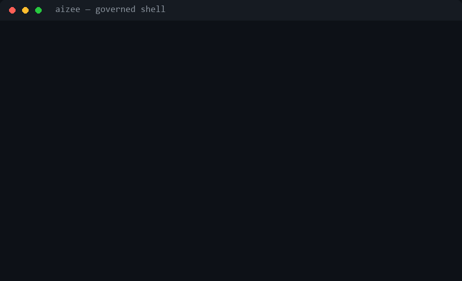

<!-- mcp-name: io.github.m3taz-ahmed/aizee -->
<div align="center">
  
  <h1>aiZee</h1>
  <p><strong>Your AI agent ships hallucinated APIs and secrets.<br>aiZee blocks them — enforced, not advised.</strong></p>

  <p>
    
    
    
    
  </p>
  <p>
    
    
    
    
  </p>
</div>

---

[Read this in Arabic](https://github.com/m3taz-ahmed/aizee/blob/main/README-AR.md) · [Changelog](https://github.com/m3taz-ahmed/aizee/blob/main/CHANGELOG.md) · [Installer Guide](#installation) · [llms.txt](https://github.com/m3taz-ahmed/aizee/blob/main/llms.txt)

---

## See it block something

<div align="center">
  
</div>

```console
$ aizee check 'Bash' --args '{"command":"git add .env && git commit -m keys"}'
{
  "ok": false,
  "decision": "deny",
  "reason": "guardian: commits secrets file .env"
}

$ aizee doctor --json | jq .verdict
"ready"
```

Every tool call, LLM request, memory write, and file change flows through
`Kernel.act()` — **Probity → Guardian → Policy → LoopDetector → Budget →
Audit** — so a denial is a wall, not a suggestion.

## What is aiZee?

A **zero-compromise, version-controlled operating system** that sits between you and every AI coding assistant — Cursor, Claude, Copilot, Windsurf, Cline, Aider, Devin — enforcing engineering standards, security policies, and architectural discipline on every line of generated code.

**The problem it solves:** AI assistants hallucinate APIs, forget conventions, ignore security, and silently ship technical debt. aiZee forces them to read from a centralized source of truth *before* writing a single line — and in v6, every action is verified *while* it executes, not just documented after.

| Without aiZee | With aiZee |
| :--- | :--- |
| Context drift after a few prompts | Rules + personas hard-loaded every session |
| Deprecated packages, silent tech debt | Exact-version tech-stack locked via live MCP docs |
| Raw SQL, missing XSS, weak secrets | OWASP, zero-trust, RBAC enforced by default |
| Random drive-by refactoring | Surgical changes through policy + budget + audit gates |
| Guardrails that exist but aren't on the path | **v6: enforcement wired into `Kernel.act()` + every MCP call** |

---

## What's New in v6.9.0 — Creative-Tools Adoption Pass

Ten architectural patterns adopted (clean-room reimplementations) from a
study of ten open-source creative tools — OpenToonz, Friction, FreeMoCap,
Synfig, Effekseer, Theatre.js, Pencil2D, OpenVDB, SVG.js, Natron — for
programmers *and* designers (report: `ideas-repo-study-2026-11.md`):

- **Event bus** (FreeMoCap) — typed pub/sub inside the kernel:
  `ActionEvent`/`StepEvent`/`TaskEvent` auto-register, bounded history,
  `state/events.jsonl` sink, dashboard SSE drain, `aizee events tail`.
- **Step memoization** (Natron) — `call` steps cache by
  `sha256(tool+args)`; `aizee plan run --memo` replays identical work
  without re-invoking tools.
- **Fluent plan builder** (SVG.js) — `runtime/plan_builder.py`:
  `plan().let_().call().fanout().suspend().return_()` emits the same
  validated inert JSON; authoring plans no longer means hand-editing JSON.
- **Predictive prefetch** (OpenToonz) — `--lookahead N` warms upcoming
  steps' tools/files on a background worker (read-only, bounded).
- **Schema-driven UI** (Theatre.js) — `aizee ui --spec '{...}'` or
  `--file <md>` renders control panes (sliders/enums/lists) from schemas;
  `GET /api/ui-schema?file=` for the dashboard.
- **Timeline replay** (Theatre.js) — `aizee replay` scrubs the
  hash-chained audit log as a dope sheet; `GET /api/replay`.
- **Task farm** (OpenToonz) — `aizee farm submit|work|reap` distributes
  work to heartbeat-ing workers with expiring leases; `GET /api/farm`.
- **Value bindings** (Synfig/Friction) — `$step.s0` and `$mem.<key>`
  namespaces resolve inside plan expressions (still no `eval`).
- **Memory snapshots** (OpenVDB) — `aizee memory snapshot` bakes an
  immutable, compacted, checksummed read-only copy of the memory DB.
- **Onion-skin ghost view** (Pencil2D) — `aizee plan ghost <file>` shows
  what a plan *would* do (done/cached/pending/gated) without executing;
- **Diff impact analysis** (Understand-Anything, MIT) — `aizee impact`
  maps changed files onto the graphify dependency graph and reverse-BFSes
  the blast radius: impacted files, tests to re-run, communities, layers.
- **Guided architecture tour** (Understand-Anything) — `aizee tour`
  walks the codebase foundations-first: graphify communities ordered by
  inbound dependency weight with per-stop file highlights and layer tags.
  shared `WorkingSet` LRU bounds event history, cache index, and prefetch.

## What's New — Unified Skill Library & BMAD Runtime (v6.8.0+)

The skill surface grew from 155 to **245 skills** — the entire agent-skills
ecosystem is now vendored, persona-mapped, trigger-enriched (EN+AR), and
integrity-locked inside the repo:

- **BMAD-METHOD vendored** — all ~34 BMAD skills (`bmad-*`, `bmod-*`) live in
  `skills/` with the project-local `_bmad/` runtime (config, scripts, ticket
  tree). Agents: **Mary** (analyst), **John** (PM), **Winston** (architect),
  **Sally** (UX), **Sofia** (PO), **Amelia** (dev) — invoked by natural
  language, no global install needed.
- **Marketing/growth suite** — ~55 skills (seo-audit, ai-seo, cro, ads,
  cold-email, launch, pricing, paywalls, onboarding, referrals, revops…)
  with bilingual triggers.
- **Lifecycle-aware persona routing** — `runtime/lifecycle.py` reads the
  active BMAD initiative (`_bmad/config.toml` + `_bmad-output/` artifacts)
  and biases persona detection toward the current phase (discovery → PRD →
  breakdown → architecture → UX → implementation → review → retro).
  Non-BMAD projects are unaffected (`phase=None` → keyword-only routing).
- **Handoff hints** — `detect_multiple` emits `next_persona_hint`, the
  highest-scoring persona outside the selected set, injected into context
  for smooth cross-domain transitions.
- **Per-project skill distribution** — `scripts/distribute-agent-skills.py`
  junctions/hardlinks all 245 skills into `.agents/skills` (every agent
  harness: Devin, Claude, Cursor, Codex…) plus `.claude/skills` and
  `.devin/skills`; nothing stays global, so unrelated sessions stay lean.
- **Trigger enrichment + lint** — imported skills got Arabic glossary
  triggers; `scripts/enrich-imported-triggers.py` /
  `enrich-bmad-triggers.py` are idempotent and re-runnable after upstream
  updates.
- **FINOPS persona fixed** — new dedicated `finops` skill replaces the
  mismatched `performance-engineer` mapping.
- **External deps manifest** — `deps.yaml` declares every tool aiZee
  features need (binaries, pip, git-repos, docker, env); `aizee deps
  check|install` verifies and provisions them (see
  [External Tooling](#external-tooling--auto-provisioning)).

Full analysis: `tech-stack/persona-bmad-review.md`.

## What's New in v6.7.0 — vercel-labs Adoption Pass

From a survey of all 396 vercel-labs repos (28 deep-studied; report in
`vercel-labs-study-2026-11.md`):

- **Inert plan engine** — `aizee plan validate|run|resume` runs
  callscript-style JSON plans: no eval, all-issues validation, bounded
  fan-outs/call budgets, suspend/resume that never re-runs settled side
  effects, auditable `plan_hash`.
- **Skill lock + drift** — `skills-lock.json` pins every skill by folder
  hash (`skillFolderHash` equivalent); `aizee skill lock-check` reports
  changed/missing/unlocked, `lock-update` rebuilds.
- **Canonical SKILL.md lint** — kebab-case dirs, exact `SKILL.md`, 500-line
  progressive-disclosure cap, folded into `aizee skill lint`.
- **MCP tool-surface freeze** — `aizee mcp freeze <server> [--check]`
  snapshot-locks tool definitions and detects added/removed/changed tools.
- **Doc→code drift gate** — `aizee check-docs` validates
  `wiki path#symbol refs` links across docs (lat.md-style).
- **Offline models.dev catalog** — `aizee models --catalog [--query]`:
  886 models/12 providers vendored snapshot.
- **Error contract** — `AizeeError.scope`/`public` + `to_public_dict()`
  redaction for safe MCP/CLI envelopes.
- **Activation layer** — every capability is wired for automatic use, not
  just installed: a `Command Surface & Auto-Triggers` section in
  `AGENTS.md` (propagated to all agent adapters) + four trigger skills
  (`inert-plan-runner`, `mcp-surface-integrity`, `docs-drift-check`,
  `skill-lock-integrity`) so persona-detection surfaces the right
  command at the right moment, and event rules fire the gates
  (post-install → lock-check, MCP change → freeze --check, doc edit →
  check-docs) without being asked.

## What's New in v6.6.0 — Repo-Study Adoption Pass

Adopted from a structured study of google/elephant-goldfish-model,
wotschofsky/domain-digger, and godotengine/godot
(full report in `repo-study-2026-11.md`):

- **Goldfish spec review** — `aizee spec review <spec_id|--file> [--preset]`
  plans a fresh-zero-context reviewer pipeline (EGM port): semantic
  spec/plan split, 5-stage reviewer personas, severity triage +
  traceability consolidation. Vendored Apache-2.0 rubrics + personas live
  under `resources/`; workflow: `workflows/65-goldfish-review.md`.
- **Multi-harness skill packaging** — `aizee skill link --pack <dir>`
  emits an EGM-style portable bundle: canonical `plugin.json` plus
  `.claude-plugin/`, `.codex-plugin/`, `.cursor-plugin/`, `.agents/`
  manifests, vendored `skills/`, `agents/` personas, and `resources/`
  rubrics. Replacement is fail-closed on non-bundle destinations.
- **Domain intelligence toolkit** — `aizee intel <domain>` plus 7 MCP
  tools (`runtime/dns_wire.py` + `runtime/domain_intel.py`, a Python
  rewrite of domain-digger concepts): wire-format DNS codec, UDP→TCP
  fallback, iterative authoritative walking, DoH, WHOIS, certificate
  history, and subdomain enumeration — all bounded and fail-closed.
- **Skill scenario evals** — `eval/skill_scenarios.py` runs static/live
  behavioral checks (`eval/scenarios/goldfish-review.yaml`) and feeds the
  eval harness as a `skill-scenarios` gate.
- **Godot reference** — full engine source pinned under `refs/godot`
  (local-only) + `tech-stack/godot-4.md` records the verified portable
  install (`4.7.2.stable.official`) for the GAME vertical.

## What's New in v6.1.0 — Lean Surface

The headline change: **the default surface is small and honest**. The MCP fleet is reduced to what is actually used, marketing tool modules are gated off instead of deleted, dead code is gone, and installers remove retired files on upgrade.

### Lean defaults

- **3 MCP servers by default** — `aizee` (governance), `graphify`, `context7`. The marketing/social/freelance MCP servers are gone from every shipped config.
- **46 MCP tools enabled** — 7 marketing-domain tool modules (ads, analytics, CRO, email, freelance, SEO, social) still ship but are disabled via `disabledToolModules` in `aizee_mcp/config.json`. Remove a name to re-enable it.
- **31 plugins disabled** — `plugins.yaml` ships them `enabled: false`; the sandbox blocks the rest. `code2video`, `graphify`, `context7` stay on.
- **Dead code removed** — unused runtime modules (`a2a_server`, `semantic_search`, `provider_registry`, `sql_injection_guard`, `plugin_system`, …) and their tests deleted.

### Upgrade hygiene

- **Stale-file cleanup** — `scripts/stale_files.txt` lists retired paths; `install.ps1`, `install.sh`, and `scripts/update.py` delete them from existing installs while preserving `state/`, `brain/`, and `.env`.
- **Unified test tree** — all tests live under `tests/{runtime,memory,eval,aizee_mcp,…}`.
- **Design library seeded** — `design-library/` now ships real `DESIGN.md` seeds (editorial, midnight, minimal) so `DesignLibrary` no longer resolves an empty catalog.
- **`Memory.md` self-compaction** — kept under its 500-line budget via `aizee memory compact` (archive in `memory/archive/`).

### v6.0.0 recap — Governed Runtime

Enforcement moved onto the execution path in v6.0.0:

- **`runtime/enforcement.py`** — unified helper: MCP firewall → AgentGateway request checks → execution → gateway response checks → audit. Shared by every call path.
- **`Kernel.act()`** — AgentGateway verdicts (ALLOW / REDACT / BLOCK) now gate real actions; prompt-injection and secret-leak checks apply to prompt-like fields without blocking ordinary file writes.
- **Outbound MCP** — `McpClient` (sync + async) and `McpAgent` run the firewall and gateway around every external tool call.
- **Inbound MCP** — the aiZee server's tools keep RBAC *and* get gateway wrapping.

### Detection depth

- **Injection detector L1→L3** — 13-technique regex layer + L2 embedding-similarity layer + optional L3 LLM-judge hook. Deterministic/model-free by default.
- **Dual-LLM hardening** — quarantined worker output is schema-enforced via Pydantic; parse failure is fail-safe.
- **MCP 2026-07-28 stateless** — per-request `protocolVersion` negotiation + `Mcp-Method`/`Mcp-Name` header routing (`runtime/mcp_protocol.py`).

### Governance depth

- **APL verdicts** — policies can now `modify` (rewrite payloads, audited) and `observe` (log-only) in addition to allow/ask/deny.
- **Lifecycle hooks** — `output.pre_send` and `memory.pre_write` phases; hooks can veto or mutate.
- **`aizee heal`** — safe autofix orchestrator (dry-run default, `--apply` with confirmation, audit to `state/heal.log`).
- **Per-PR budgets** — cumulative spend limits keyed by PR id (`AIZEE_PR_ID`), on top of session/hour/day windows.
- **Release gate** — `eval/release_gate.py` runs the reliability priority ladder over recorded rollouts; wired into `aizee ci`.
- **Chaos suite** — `eval/chaos.py` fault-injection scenarios + error-budget math.

### Memory & protocol surfaces

- **Bi-temporal memory** — `store.as_of(as_of=..., valid_at=...)` answers "what did we know then" and "what was true then" separately; `pinned`, soft-delete with tombstone-time queries, contradiction relations.
- **`aizee memory compact`** — `Memory.md` auto-compaction (500-line budget, `[PINNED]` rescue, archive under `memory/archive/`).
- **Code Mode** — `aizee codemode` executes sandboxed Python snippets that call MCP tools directly (AST scan + restricted builtins + governed bridge + timeout).
- **`aizee bootstrap`** — materialize a minimal OS root after `pip install aizee` (idempotent, dry-run default).
- **Advisory audits** — `aizee task overcheck` (over-engineering signals from plan + graph), `aizee task curriculum` (staged learning plan from tech-stack refs).
- **Cross-harness handoffs** — `aizee memory handoff --to-harness <h>` stamps a portable `aizee.handoff.v1` doc into the scoped vault (`brain/handoffs/`, fail-closed gitignore guard) so another agent picks up exactly where this one stopped.
- **Instincts** — `aizee memory instinct-*` records atomic trigger→action behaviors with confidence 0.3→0.9; observed in ≥2 projects → auto-promotes project→user scope.
- **MCP supply-chain audit** — `aizee security mcp` scans discovered MCP configs (JSONC-tolerant) for plaintext/token-shaped secrets in `env` *and* `args`, unpinned `npx`/`uvx` packages, writable command paths, and rug-pull drift vs locked baselines.
- **Fact-forcing guardrail** — recoverable destructive commands (force-push, hard reset) pass only with explicit `{target, rollback}` facts; catastrophic ones stay hard-blocked.
- **Prompt-defense baseline** — every materialized harness rules file carries a fixed anti-injection section (identity lock, secret non-disclosure, untrusted external content, unicode-trick suspicion).

Full detail: [CHANGELOG.md](https://github.com/m3taz-ahmed/aizee/blob/main/CHANGELOG.md)

---

## Quick Start

### Prerequisites

| Requirement | Minimum | Recommended |
| :--- | :--- | :--- |
| Python | 3.10 | 3.12 |
| Git | 2.30+ | Latest |
| OS | Windows 10 / macOS 12 / Ubuntu 22.04 | Latest |

### Installation

```bash
git clone https://github.com/m3taz-ahmed/aizee.git .ai
cd .ai
```

**Windows — GUI wizard** (double-click `install.bat` or run):
```powershell
.\install.ps1 -Gui
```

**Windows — CLI:**
```powershell
.\install.ps1
```

**macOS / Linux:**
```bash
bash install.sh
```

**pip (from GitHub):**
```bash
pip install "git+https://github.com/m3taz-ahmed/aizee.git"
aizee bootstrap --target ~/.aizee --yes   # materialize a minimal OS root
export AIZEE_ROOT=~/.aizee
```

> PyPI publication is planned; until `pip install aizee` lands, install
> from the repo directly as above (the `pyproject.toml` is real — it
> installs cleanly as an editable or git package).

**Installer map** — the `.bat` files are thin launchers, not separate installers:

| Entrypoint | Real implementation | Preserves `state/`/`brain/` |
| :--- | :--- | :--- |
| `install.ps1` / `install.sh` | The actual installers (copy + in-place modes) | Yes |
| `install.bat` | → `installer/gui_installer.ps1` | Yes |
| `update.bat` | → `scripts/update.py` (git pull + post-install) | Yes |
| `uninstall.bat` | → `runtime/uninstaller_gui.py` (fallback: `aizee uninstall`) | n/a |
| `backup.bat` / `restore.bat` | → `scripts/backup_brain.py` / `restore_brain.py` | n/a |

Both install and update run the `scripts/stale_files.txt` retirement list, so files removed from the repo are deleted from existing installs too.

### Verify

```bash
aizee doctor    # Health check (46 checks)
aizee heal      # Diagnose + safe autofixes (dry-run; --apply to fix)
aizee status    # Current persona, skills, budget
aizee deps install   # Provision external tools declared in deps.yaml
```

### Updating

For an **existing install** (not a fresh install) — one file does everything:

- **Windows:** double-click `update.bat`
- **Any OS:** `python scripts/update.py --yes`

What it does: `git fetch` → stashes any local edits (recover with `git stash pop`) → `git pull --rebase` → post-install hooks + `aizee deps check` advisory. Your learned data (`memory/`, `state/`, `brain/`, `.env`) is gitignored and always preserved. Preview first with `python scripts/update.py --dry-run`.

To jump straight to a specific release: `git checkout vX.Y.Z` then `python scripts/update.py --post-install-only`.

---

## External Tooling & Auto-Provisioning

aiZee features sometimes need software that lives **outside** this repo —
CLI tools, pip packages, media kits, docker images, API keys. All of it is
declared in **`deps.yaml`** (44 entries) so nothing is a silent missing
requirement:

```bash
aizee deps check            # Report every dep: ok / missing / wrong version
aizee deps check --tag video # Filter by group (video, devx, agent, media…)
aizee deps install           # Provision everything unsatisfied (per-OS cmds)
aizee deps install --dry-run # Preview commands without running
aizee doctor                 # deps verdict folded into the health report
```

`install.ps1` / `install.sh` / `scripts/update.py` already run
`aizee deps check` as a post-install hook and offer to install what's
missing — so a fresh clone reaches full capability with one command.

| Category | Examples | Needed for |
| :--- | :--- | :--- |
| **Core (bundled)** | Python 3.10+, SQLite, pyyaml, pydantic | Everything — zero extra installs |
| **DevX CLIs** | repomix, code2prompt, oxlint, agent-browser | Context packing, repo→prompt, JS lint, agent browsing |
| **Spec/SDD** | specify (spec-kit), openspec, spec-kitty, spec-workflow-mcp | Spec-driven development workflows |
| **Automation** | n8n, super-productivity, gitbutler | Workflow automation, PM, git branches |
| **Media kits** | cinecode, bang-motion, motion-graphics (`~/.aizee/media`) | Video/motion production (optional) |
| **ComfyUI** | `~/.aizee/media/apps/ComfyUI` + custom nodes | Local image/video generation (optional, GPU) |
| **Docker** | Docker Desktop + `code2video` image | code2video plugin rendering (optional) |

**Optional by design:** media/video deps are `severity: optional` — core
governance, personas, skills, memory, and MCP work fully without them.
`aizee deps check` tells you exactly what each feature is missing and the
one command that fixes it.

---

## Core Architecture

```
.ai/                         # Sovereign root (discovered via AIZEE_ROOT)
├── AGENTS.md                # Cross-tool canonical bootloader
├── global-roles.md          # 29 personas + operational rules
├── global-workflow.md       # Cognitive loading & execution protocol
├── runtime/                 # Kernel: policy, budget, audit, 151 governance modules
│   ├── kernel.py            # Facade — Probity → Guardian → Policy → Loop → Budget → Audit
│   ├── enforcement.py       # Unified firewall+gateway enforcement helper
│   ├── agent_gateway.py     # Request/response guardrails (ALLOW/REDACT/BLOCK)
│   ├── injection_detector.py# L1 regex + L2 embeddings + L3 LLM-judge
│   ├── lifecycle.py         # BMAD phase detection → persona routing bias
│   ├── codemode/            # Sandboxed code-mode tool execution
│   └── policies/            # default/guardian/probity/mcp_firewall YAMLs
├── memory/                  # SQLite + FTS5 + vector, bi-temporal queries
├── aizee_mcp/               # MCP server (46 tools enabled, 3 resources)
├── eval/                    # Benchmarks, chaos, reliability, release gate
├── skills/                  # 245 persona + lord + BMAD + marketing skills
├── _bmad/                   # BMAD runtime (config/scripts — gitignored)
├── .agents/skills           # Junction distribution for agent harnesses
├── deps.yaml                # External dependency manifest (check/install)
├── workflows/               # 66 trigger-based execution protocols
├── rules/                   # Compressed behavioral rules
├── tech-stack/              # 271 version-locked stack references
├── dashboard/               # Web dashboard (Python stdlib HTTP)
├── scripts/                 # Installers, validators, MCP wrappers
├── install.ps1 / install.sh # Idempotent OS installer
└── pyproject.toml           # Package metadata + quality config
```

---

## The Six Pillars

### 1. Persona + Skill Composition
29 personas (`ARCH`, `QA`, `SEC`, `DEV`, `SRE`, `DATA`, `ML`, `MLOPS`, `FINOPS`, `DEVOPS`, `API`, `FREELANCE`, `MARKETING`, `GROWTH`, `BRAND`, `EMAIL`, `SOCIAL`, `CRO`, `SALES`, etc.) with lord-level domain skills — auto-detected per task, no manual selection needed.

Two routing layers on top of keyword scoring:

- **Lifecycle phase bias** — when a BMAD initiative is active, `_bmad-output/`
  artifacts reveal the current phase (PRD → architecture → stories → review)
  and `runtime/lifecycle.py` biases selection toward the matching persona
  (e.g. mid-implementation → `DEV`, mid-review → `QA`+`ARCH`).
- **Handoff hints** — the result carries `next_persona_hint`: the strongest
  persona outside the selected set, so cross-domain tasks ("review the
  design, then implement") transition cleanly.

```bash
aizee persona detect --multi "build a secure docker API with postgres"
# → Primary: ARCH + Secondary: SEC, DEVOPS + Lords: security-lord, cloud-platforms-lord
# + lifecycle_phase / next_persona_hint when a BMAD initiative is active
```

### 2. Runtime Governance
Every action passes through the gate pipeline before execution:

```
Probity → Guardian → Policy → Loop Detector → Budget → Audit
        └─ AgentGateway: injection + secret-leak verdicts (v6)
```

- **Policy engine** — `allow/ask/deny/modify/observe` YAML rules with AST-safe evaluation
- **MCP firewall** — rule-based outbound tool-call gate (deny destructive, ask unknown)
- **AgentGateway** — prompt/response guardrails on every enforced path
- **Budget manager** — token/cost/call limits per session/hour/day/week/month **and per PR**
- **Audit logger** — SHA-256 hash-chained, Ed25519-signed, tamper-evident trail
- **Workflow runner** — durable SQLite-backed execution with saga compensation

### 3. Live Ground-Truth
Context7 MCP fetches current library docs before implementation. Graphify knowledge graph replaces blind `grep` for codebase navigation.

### 4. Hybrid Memory
SQLite + FTS5 full-text + optional vector index (SentenceTransformers). Episodic, semantic, factual, procedural layers — now with pinning, soft-delete, contradiction links, HMAC integrity, and bi-temporal `as_of` queries.

```bash
aizee memory ingest                # Rebuild index after changes
aizee memory search "docker"       # Full-text + vector search
aizee memory compact               # Keep Memory.md under its line budget
```

### 5. Quality Gates (Zero Defect)
```bash
ruff check .                 # 0 warnings
mypy                         # Strict typing
aizee test --full            # full suite + coverage (fail-under=100)
python eval/harness.py       # E2E eval: ruff + mypy + pytest + validate-globals
```

### 6. Token Efficiency
Persona detection is local (pure Python, zero LLM tokens). Code Mode replaces tool-call JSON ping-pong with sandboxed snippets that invoke tools directly — materially fewer orchestration tokens on multi-tool tasks.

---

## Runtime Enforcement Map

| Path | Gates applied |
| :--- | :--- |
| `Kernel.act()` | Probity → Guardian → Policy → Loop → Budget → Audit + AgentGateway prompt checks |
| Outbound MCP (`McpClient`, `McpAgent`, `aizee mcp call`) | mcp_firewall → gateway request → execute → gateway response |
| Inbound MCP (`aizee_mcp` tools) | RBAC + gateway request/response wrap |
| Chat (`kernel.chat_message`) | prompt_gate → … → `output.pre_send` hooks |
| Memory writes | `memory.pre_write` hooks (veto/mutate) + HMAC integrity |
| Code Mode (`aizee codemode`) | AST sandbox scan + restricted builtins + governed `call_tool` |

---

## Dashboard

```bash
python dashboard/server.py 8080
# → http://127.0.0.1:8080
```

Dark-first command-center UI: command palette (`Ctrl+K`), bento-grid metrics, status pills, glass panels. Optional Bearer auth via `AIZEE_DASHBOARD_TOKEN`.

**Tabs:** Overview · Memory Explorer · Policy Sandbox · Workflows · Sagas · Chat · Tech Stack · Telemetry · System Health · Audit Logs · **Settings**

> **Important — disable MCP servers you don't use.** Every enabled MCP server consumes memory and may spawn a subprocess on first tool call. After installation, open **Settings → MCP Servers**, uncheck what you don't need (**Uncheck All** then re-check), and **Save Changes**. The kernel auto-reloads on save.

Settings persist to `state/settings.json` (gitignored, survives updates). Schema migrations run automatically — old files are backed up.

---

## Key Commands

| Command | Purpose |
| :--- | :--- |
| `aizee doctor [--json]` | Health verdict + ordered Run:/Guidance: fix steps |
| `aizee heal [--apply] [-y]` | Diagnose + safe auto-fixes (dry-run default) |
| `aizee check <action>` | Policy verdict for an action |
| `aizee find "<need>"` | NL search over skills/workflows/tech-stack |
| `aizee goal "<objective>"` | Map a goal to the best workflow + steps |
| `aizee config show` | Masked settings snapshot |
| `aizee config apply <file> --check` | Validate a settings file (no write) |
| `aizee spec propose\|changes\|archive` | OpenSpec-style change folders |
| `aizee gateway init\|serve` | Governed LLM proxy (failover + enforcement) |
| `aizee models` | Model routing catalog (tiers + cost) |
| `aizee work poll` | Open GitHub issues via `gh` (pull model) |
| `aizee skill link` | Install SKILL.md into agent harnesses |
| `aizee skill lint [--write-index]` | Description lint + trigger-collision detection |
| `aizee skill scan` | Prompt-injection / exfiltration scan of skills |
| `aizee hooks install\|status` | Wire aiZee hooks into agent harnesses |
| `aizee abstract [--force]` | Generate L0 `.abstract.md` tiered summaries |
| `aizee session from-curl\|from-har` | Inspect a captured API auth bundle |
| `aizee memory compact [--apply]` | Compact Memory.md to its line budget |
| `aizee codemode --code/--file` | Sandboxed snippet calling MCP tools |
| `aizee task overcheck` | Over-engineering audit of the active plan |
| `aizee task curriculum --stack …` | Staged learning plan from tech-stack refs |
| `aizee bootstrap --target DIR` | Materialize an OS root (post-`pip install`) |
| `aizee ci` | Full CI gates incl. reliability release gate |
| `aizee security scan <path>` | SAST + external scanner orchestration |
| `aizee deps check\|install [ids]` | Verify/provision external deps (deps.yaml) |
| `aizee skill lock-check\|lock-update` | Skill integrity: drift detection / re-lock |
| `aizee mcp freeze <srv> [--check]` | Snapshot-lock MCP tool surface |
| `aizee check-docs` | Validate `[[file#symbol]]` doc references |
| `aizee spec review <spec>` | Goldfish reviewer-pipeline plan |
| `aizee intel <domain>` | DNS/WHOIS/certs/subdomain recon |
| `aizee eval` | Behavioral skill-scenario checks |
| `aizee persona detect --multi` | Multi-persona + lifecycle phase + hints |
| `aizee plan ghost <file>` | Onion-skin preview: what a plan would do |
| `aizee plan run --memo --lookahead N` | Cached steps + predictive prefetch |
| `aizee replay [--tail N]` | Scrub the audit log as a timeline |
| `aizee events tail\|stats` | Event bus log (kernel action events) |
| `aizee farm submit\|work\|reap` | Task farm with worker leases/heartbeats |
| `aizee ui --file <md>\|--spec '{json}'` | Schema-driven control panes |
| `aizee memory snapshot [--out DIR]` | Immutable compacted memory export |
| `aizee impact [--base ref]` | Blast radius of pending changes over the code graph |
| `aizee tour [--stops N]` | Dependency-ordered guided architecture walkthrough |

---

## Quality Gates

| Gate | Command | Status |
| :--- | :--- | :--- |
| Lint | `ruff check .` | 0 warnings |
| Types | `mypy` | 0 errors (strict) |
| Tests (fast) | `aizee test` | fast tier, no coverage |
| Tests (full) | `aizee test --full` | full suite, coverage floor 100% |
| Integrity | `scripts/validate-globals.py` | 1242 files, 0 errors |
| Docs sync | `scripts/sync_docs.py --check` | in sync |
| E2E | `python eval/harness.py` | all gates pass |
| Release | `python eval/release_gate.py` | reliability ladder over rollout evidence |

---

## Tech Stack

- **Core:** Pure Python 3.10+ (no Node.js required for core OS)
- **Memory:** SQLite + FTS5 + optional SentenceTransformers vectors
- **MCP:** FastMCP server, 46 tools enabled by default (7 marketing tool modules ship gated via `disabledToolModules`)
- **Dashboard:** Python stdlib HTTP server + SQLite
- **Knowledge graph:** graphify (optional)
- **Dependencies:** pyyaml, pydantic, rich, cryptography, numpy, turbovec

---

## How aiZee compares

aiZee is not a skills collection or a process framework — it is the **policy layer** that governs what any of them may do. The categories compose:

| | aiZee | BMAD-METHOD | spec-kit | claude-skills |
| :--- | :--- | :--- | :--- | :--- |
| **Category** | Governance + agent OS | Agile-ai process | Spec-driven toolkit | Skill library |
| **Enforcement** | Runtime gates on every action | Process conventions | Spec templates | None (content only) |
| **Skills** | 245 vendored, hash-locked | ~34 `bmad-*` | Templates | 410+ |
| **Personas** | 29 auto-detected + lifecycle-aware | 6 named agents | — | — |
| **Memory** | Hybrid SQLite + vectors, bi-temporal | `persistent_facts` files | — | — |
| **MCP** | Server (46 tools) + client firewall | — | — | — |
| **Install** | `pip install aizee` | `npx skills add` | `uvx specify` | `npx skills add` |
| **Best for** | Governing what agents *may do* | Running the agile-ai lifecycle | Spec-driven workflows | Plug-and-play skills |

**They compose, not compete:** aiZee can govern BMAD workflows end-to-end (its `_bmad/` runtime is detected by `runtime/lifecycle.py`), ingest skills from any agent-skills repo into its locked library, and enforce policy over spec-kit-driven development.

---

## Contributing

1. Fork → feature branch (`feature/*`)
2. Write tests first (AAA pattern, one behavior per test)
3. Run `ruff check . && mypy && pytest -q && python eval/harness.py`
4. All gates must pass — no PR without green
5. Conventional commits: `type(scope): subject`
6. PR ≤ 400 lines, targeted tests only

---

## Ecosystem & Distribution

aiZee ships its own MCP server and agent-facing skill. The surfaces below make
it discoverable to agents and humans — some require maintainer accounts:

| Surface | What it unlocks | Status |
|---|---|---|
| **PyPI** (`aizee`) | `pip install aizee` — the README's install path | ⏳ pending publication |
| **Official MCP servers list** | Listed in `modelcontextprotocol/servers` — where Claude/Cursor users discover MCP tools | ⏳ PR needed |
| **mcpservers.org / Smithery / Glama** | MCP directories with one-click install | ⏳ submission needed |
| **awesome-claude-code / awesome-mcp** | Curated lists that drive most early stars | ⏳ PR needed |
| **GitHub social preview** | The image shown when the repo is shared on X/LinkedIn/Discord | ⏳ needs a banner image (1280×640) |
| **Demo GIF** | The money shot: agent blocked mid-commit | ⏳ record with ScreenToGif/asciinema+agg |
| **Show HN · r/ClaudeAI · r/cursor** | Launch traffic | ⏳ after the above land |
| **Dev.to / Hashnode post** | Searchable launch write-up | ⏳ optional |

Everything else (topics, description, release, `llms.txt`, root `SKILL.md`,
`aizee skill link` into agent harnesses) is already shipped.

---

## License

MIT — see [LICENSE](https://github.com/m3taz-ahmed/aizee/blob/main/LICENSE).

---

<div align="center">
  <p><strong>aiZee</strong> — The policy layer for AI coding.</p>
  <p>Built by <a href="https://linkedin.com/in/m3taz-ahmed">Moataz Ahmed</a></p>
</div>
